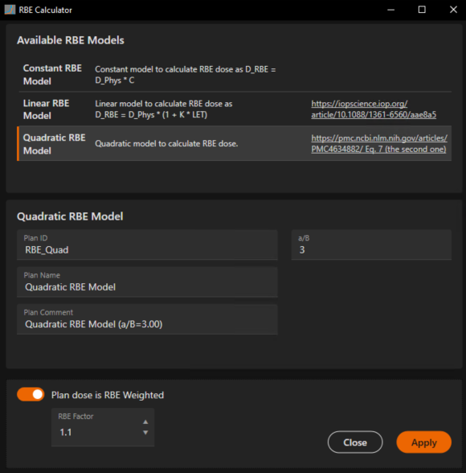
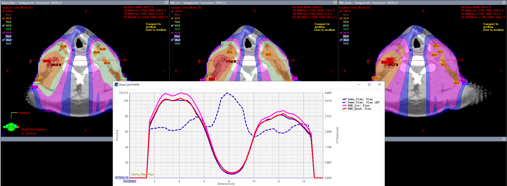

# MAAS-ProtonRBE

ProtonRBE is an ESAPI script plugin for Varian Eclipse that provides a graphical user interface for calculating RBE-weighted dose distributions for proton therapy plans.

**User Interface Screenshot**
<br>


<br>

**Calculation Results Screenshot**
<br>
Left:Original plan dose, Center: RBE calculated with linear model, Right: RBE calculated with quadratic model
<br>


## Description

The script runs within the Eclipse Treatment Planning System v19.0 or newer, and presents a WPF-based interface for:

- Selecting and configuring RBE calculation models
- Processing proton plans with valid dose and LET matrices
- Creating new evaluation plans with RBE-weighted dose distributions
- Monitoring calculation progress
- Reviewing calculation results

## Features

### Supported RBE Models

1. **Constant RBE Model**
   - Simple fixed RBE multiplier approach
   - Formula: `D_RBE = D_Phys × C`
   - Default constant: 1.1
   - Configurable parameter: C

2. **Linear RBE Model**
   - LET-dependent linear model
   - Formula: `D_RBE = D_Phys × (1 + K × LET)`
   - Default K value: 0.055
   - Configurable parameter: K
   - Reference: [Carabe et al. 2012](https://iopscience.iop.org/article/10.1088/1361-6560/aae8a5)

3. **Quadratic RBE Model**
   - McNamara's phenomenological RBE model
   - Accounts for both LET and tissue α/β ratio
   - Configurable parameter: α/β (default: 1.0)
   - Reference: [McNamara et al. 2015](https://pmc.ncbi.nlm.nih.gov/articles/PMC4634882/)

### User Interface

The application provides:
- Model selection list
- Parameter configuration for each model
- Custom plan ID and naming
- Progress tracking during calculations
- Status notifications
- Error handling with user-friendly messages

## Usage

### Prerequisites

Before running the script:
- Patient must be open with a valid proton (ion) plan setup
- Plan must have calculated dose and LET
- Patient must be available for modifications (script requires write access)

### Running the Script

1. Open a proton plan with valid dose and LET.
2. Run `ProtonRBE.esapi.dll` from Eclipse's script menu.
3. Accept the license agreement on first use.
4. Select an RBE model, adjust parameters and plan ID/name, and click **Apply**.
5. A new evaluation plan with the RBE-weighted dose is created.

## Output

The script creates:
- A new evaluation plan with RBE-weighted dose
- Plan ID formatted as specified by the user
- Plan comments including model details and parameters

## Logging

Logs are written using Serilog to:
```
C:\VMSOS\Log\Application\ProtonRBE\RBE_<timestamp>.txt
```

## Dependencies

- VMS.TPS.Common.Model.API (Varian ESAPI)
- Prism.Core (MVVM framework)
- Serilog (Logging)
- EulaVerification (license acceptance)
